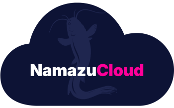

<p align="center">
  <a href="https://cloud.namazustudios.com"></a>
</p>

# namazu-cloud-addon-custom-dns

Full **custom DNS** as a shared addon: a tenant routes a hostname they
*own* — `play.them.com` — to their instance through
**CloudFront SaaS Manager**, with a CloudFront-managed TLS certificate per
hostname, instead of being reachable only at their reserved
`cloud.namazustudios.com` subdomain.

One repo = one addon = one Terraform root (contract:
[`tenant-addons-plan.md`](https://github.com/NamazuStudios/namazu-cloud-instance/blob/main/tenant-addons-plan.md)).
Inert by design: no CI, no bootstrap, no AWS role — an org fork executes
this root under **its** executor role at a pinned ref. There is no
statically-bound config: **the consuming fork's matrix entry IS the request
and the config** (the runner's `contract` input), and the inputs are
deliberately default-less — no contract values, no valid plan.

Design of record: the **Custom DNS Addon** Design Notebook (Namazu Cloud
Design Notebook, org *Namazu Studios*) — every decision below (SaaS Manager
over per-tenant standard distributions, managed certs, the provider-subdomain
CNAME pattern, host-header strategy B, the two-step activation contract) is
recorded there with its rationale and its research citations.

## What it creates (per install)

- **One CloudFront distribution tenant per custom hostname** on the
  platform's multi-tenant distribution (`distribution_id`), each with:
  - a **CloudFront-managed ACM certificate** (us-east-1, auto-renewed,
    HTTP validation, `validation_token_host = cloudfront`) — the tenant
    never publishes an ACM validation record; and
  - `wait_for_deployment = false` — deliberately, see *How activation
    works*.
- **The provider-subdomain indirection**, per custom hostname, in the
  reservable zone (`subdomain_zone_id`):
  - `<slug>.<zone> CNAME <connection group routing endpoint>` — the stable
    name the tenant's domain points at;
  - `_cf-challenge.<slug>.<zone> TXT <connection group routing endpoint>` —
    the managed-certificate domain-ownership record.
  The tenant publishes **exactly one CNAME and zero TXT records**.
- **Optional `cloud_domains` routing rows** (`register_routing = true`):
  the custom hostname's Host header is forwarded end to end (strategy B —
  the instance's CORS and host-dependent behavior need the real Host), so
  cloud-proxy must answer for the custom hostname. The row is **mirrored,
  never invented**: the tenant's existing reserved-subdomain row is read
  by fqdn (`source_fqdn`) and copied — `instance`, `instance_fqdn`,
  `port`, `owner` — so this addon can never disagree with what the
  platform registered. Default **false** while the design notebook's open
  question *who writes cloud_domains* (direct write vs a control-plane
  endpoint) is unsettled.

Nothing is written inside the tenant's own DNS zone (we have no access to
it) and nothing is written into the tenant's namespace — the whole addon
lives on the AWS side, sweep-destroyed with the entry.

## Platform prerequisites (NOT in this repo)

| Prerequisite | Owner | State |
|---|---|---|
| CloudFront **multi-tenant distribution** (origin = `cloud-proxy.<zone>`, HTTPS-only, cache policy with no caching, **origin request policy that forwards the `Host` viewer header** — strategy B) | `namazu-cloud-terraform` global module | tracked in the platform issue referenced from the design notebook |
| **Connection group** (routing endpoint handed to this addon) | `namazu-cloud-terraform` global module | same issue |
| Inherited wildcard cert (`*.<zone>`) on the cloud-proxy ALB | exists today | verified — covers the origin name |

## Inputs (per entry, via the runner's `contract`)

| Input | Type | Required | Notes |
|---|---|---|---|
| `custom_domains` | list(string) | **yes** | hostnames the tenant owns; one distribution tenant + certificate each. New domains only — no migrating-live-domains path in v1 |
| `distribution_id` | string | **yes** | the platform's multi-tenant distribution id |
| `connection_group_endpoint` | string | **yes** | the connection group routing endpoint (`dXXXX.cloudfront.net`) |
| `subdomain_zone_id` | string | **yes** | reservable zone the slug records are written into |
| `subdomain_zone_name` | string | **yes** | its DNS name (e.g. `cloud.namazustudios.com`) |
| `connection_group_id` | string | no | omit to use CloudFront's default connection group |
| `register_routing` | bool | no | default `false` — the cloud_domains row-writer decision is open in the design notebook |
| `source_fqdn` | string | when `register_routing` | the tenant's reserved subdomain whose routing row is mirrored |
| `cloud_domains_table` | string | when `register_routing` | e.g. `production_cloud_domains` |
| `slug_ttl` | number | no | slug/challenge record TTL, default 300 |

## Outputs (per install, `$addon.custom-dns.<variant>.<output>`)

| Output | Type | What it is |
|---|---|---|
| `custom_domains` | map(object) | per hostname: `distribution_tenant_id`, `distribution_tenant_arn`, `status` (`PendingValidation` → `Deployed`), `slug_fqdn`, and the `tenant_cname` (name/type/target) the tenant must publish |
| `activation_instructions` | string | the exact copy to hand the tenant — one CNAME line per hostname, nothing else |
| `routing_rows_registered` | bool | whether the cloud_domains rows were written (strategy B live or not) |
| `instance_cors_hostnames` | list(string) | the custom hostnames the instance's CORS allow-list must additionally accept — the second out-of-band activation step |

## How activation works (the two-step contract)

This addon is the first in the family whose completion depends on an actor
outside Terraform: the tenant's DNS administrator. **Apply #1 never blocks
on them.**

1. Apply #1 mints the distribution tenants, certificates (pending), slug
   records, and optional routing rows — `wait_for_deployment = false`, so
   it completes immediately. The outputs carry the exact CNAME to publish.
2. The tenant publishes `<custom hostname> CNAME <slug>.<zone>` at their
   registrar. The PR that adds the matrix entry carries this instruction —
   operator-curated, 100%.
3. The fork's **next apply** (cron sweep, dispatch, or the next entry
   change) reports the tenant `status`. The reporting/audit surface treats
   **`Deployed` — not the apply exit code — as green**. Routing needs no
   reconcile: the routing row is live from apply #1, and the certificate
   issuing the moment DNS points at us *is* the ownership proof.
4. An operator or the portal adds the custom hostname to the instance's
   CORS allow-list (`instance_cors_hostnames` output) — the second
   out-of-band step, output-and-don't-block.

What this rules out (by design): `null_resource` pollers, `timeouts`
pretending the tenant will act within N minutes, and any expectation that
apply #1 ends in a serving state.

## IAM / RBAC the consuming fork must grant

Documented here because shared addon repos are inert — the fork's
`iam.policy.json` / `bootstrap/` carries the actual grants:

| Grant | Scope | Why |
|---|---|---|
| `cloudfront:Create/Get/Update/DeleteDistributionTenant` | account distribution-tenant resources | the per-hostname edge objects |
| `acm:RequestCertificate`, `acm:DescribeCertificate`, `acm:DeleteCertificate` | us-east-1 certificates | CloudFront's managed-certificate flow on our behalf |
| `route53:GetHostedZone`, `ListResourceRecordSets`, `ChangeResourceRecordSets`, `GetChange` | **whole zone** (Route 53 cannot scope below a hosted zone) | the slug + challenge records — same posture every per-tenant baseline state already holds on that zone |
| `dynamodb:GetItem`, `PutItem`, `DeleteItem` | **whole table** on `cloud_domains` (only when `register_routing`) | the mirrored routing rows — table-scoped by discipline |

## Multiple instances per tenant (variant)

Every install is the triple (addon, variant, tenant) — several variants on
one tenant are independent applies. Example entry:

```yaml
- { addon: "NamazuStudios/namazu-cloud-addon-custom-dns", ref: "<pin>", variant: brand,
    instance: "<id>",
    contract: |-
      custom_domains=["play.them.com","www.them.com"]
      distribution_id=EXXXXXXXX
      connection_group_endpoint=dXXXXXXXXXXXX.cloudfront.net
      subdomain_zone_id=ZXXXXXXXX
      subdomain_zone_name=cloud.namazustudios.com }
```

Adding a hostname = edit the entry's `custom_domains` and re-run. Removing
the entry = guaranteed teardown (state sweep + namespace invariants of the
addon contract): distribution tenants, certificates, slug records, and any
routing rows go with it.

## License

AGPL-3.0 — same as every Namazu Cloud addon repo.
